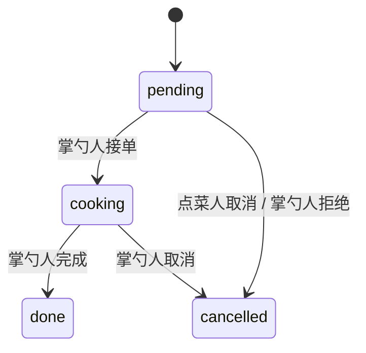

# 家庭云点菜小程序

## 项目简介

家庭内部使用的无商业点菜工具：点菜人负责“今天想吃什么”，掌勺人负责“今天做什么”。项目不包含价格、金额、支付、余额、购物车结算等任何商业消费功能，也不产生任何实际交易。

## 目录

- [核心功能](#核心功能)
- [技术栈](#技术栈)
- [项目结构](#项目结构)
- [数据模型](#数据模型)
- [技术亮点：私有云存储下的图片共享](#技术亮点私有云存储下的图片共享)
- [本地运行指南](#本地运行指南)
- [常见问题](#常见问题)
- [安全与边界](#安全与边界)
- [参考文档](#参考文档)

## 核心功能

### 点菜人

- 使用微信头像、昵称登录，并选择“我是点菜人”
- 按分类横向浏览菜品，查看菜名、图片、分类和备注
- 通过加减按钮调整份数，底部实时显示已选份数和菜品数
- 进入确认页核对清单、填写备注后提交点单
- 在“我的点菜”中查看历史记录和状态：待接单、制作中、已完成、已取消
- 可取消自己尚未被接单的点单

### 掌勺人

- 使用微信头像、昵称登录，并选择“我是掌勺人”
- 菜品列表展示名称、分类、图片、备注和今日供应状态
- 新增、编辑、删除菜品，支持从相册或相机上传图片
- 通过开关控制某道菜“今天做 / 今天不做”
- 首页展示待接单数量，进入“今日点单”处理订单
- 按状态筛选点单，执行接单、做好、取消等操作

### 通用

- 数据通过云数据库实时同步，家人使用不同微信账号也能看到同一份菜单和点单
- 菜品图片存储在云存储，数据库只保存云文件 ID
- 无价格、无支付、无购物车结算、无余额
- 未上传图片时使用菜品首字和稳定色块作为占位，不会出现空白卡片

## 技术栈

| 分类 | 技术 |
| --- | --- |
| 小程序端 | 微信原生小程序（WXML / WXSS / JavaScript），未使用 uni-app 或第三方框架 |
| 后端 | 微信云开发：云数据库、云存储、云函数（Node.js + wx-server-sdk） |
| 开发方式 | Trae AI 辅助开发：需求拆解、页面实现、云函数编写与问题排查 |

## 项目结构

```text
home-order/
├── app.js                          # 云开发初始化、启动时恢复登录态
├── app.json                        # 页面路由与全局窗口配置
├── app.wxss                        # 全局样式
├── sitemap.json                    # 不对外搜索
├── project.config.json             # 微信开发者工具项目配置
├── .gitignore
├── README.md
├── pages/
│   ├── login/                      # 登录与角色选择
│   ├── requester/
│   │   ├── index/                  # 点菜人首页：分类浏览、加入清单
│   │   └── confirm/                # 确认点单、填写备注
│   ├── orders/                     # 我的点菜
│   └── chef/
│       ├── index/                  # 掌勺人首页：菜品管理
│       ├── orders/                 # 今日点单处理
│       └── dish-edit/              # 新增 / 编辑菜品、图片上传
├── utils/
│   ├── store.js                    # 云数据库、云存储、会话与点菜草稿
│   └── util.js                     # 状态文案、时间格式化、占位色块
└── cloudfunctions/
    └── homeOrder/
        ├── index.js                # 集合初始化、openid、临时链接、订单状态
        └── package.json
```

> 如果仓库中还存在 `miniprogram/`、`cloudfunctions/quickstartFunctions/`、`uploadCloudFunction.sh`，它们是微信开发者工具创建云开发模板时生成的示例文件，不属于本项目，可以安全删除。本项目以根目录的 `app.json` 作为小程序入口。

## 数据模型

### users

| 字段 | 类型 | 说明 |
| --- | --- | --- |
| `openid` | string | 微信用户唯一标识，由云函数获取 |
| `role` | string | `requester`（点菜人）或 `chef`（掌勺人） |
| `name` | string | 家庭内昵称 |
| `avatar` | string | 可选，头像的云存储 fileID |
| `createTime` / `updateTime` | date | 服务端时间 |

### dishes

| 字段 | 类型 | 说明 |
| --- | --- | --- |
| `name` | string | 菜名 |
| `category` | string | 分类，如家常菜、汤羹、主食、凉菜、甜品 |
| `image` | string | 云存储 fileID，可为空 |
| `available` | boolean | 今天是否供应 |
| `note` | string | 口味、做法等备注 |
| `createTime` / `updateTime` | date | 服务端时间 |

### orders

| 字段 | 类型 | 说明 |
| --- | --- | --- |
| `requesterOpenid` | string | 点菜人 openid |
| `requesterName` | string | 点菜人昵称 |
| `items` | array | `[{ name, qty }]`，只记录菜名和数量 |
| `remark` | string | 整单备注 |
| `status` | string | `pending` / `cooking` / `done` / `cancelled` |
| `createTime` / `updateTime` | date | 服务端时间 |

状态流转：



## 技术亮点：私有云存储下的图片共享

### 问题

微信云开发的免费版环境无法在控制台把云存储权限改为“公有读”，文件默认是私有读。菜品图片由掌勺人的微信账号上传，点菜人是另一个 openid，因此：

- 直接在小程序端用 fileID 读取图片，可能被云存储权限拒绝；
- 即使把上传动作改成云函数，文件仍然是私有读，换一个用户依旧无法直接读取；
- 免费版也无法通过控制台把存储桶改成公有读。

### 方案

项目保留“客户端上传图片”的方式，但把“读取图片”改为由云函数签发临时链接：

1. 掌勺人选择图片后，小程序调用 `wx.cloud.uploadFile` 上传到云存储的 `dishes/` 目录，数据库只保存返回的 `fileID`。
2. `cloudfunctions/homeOrder/index.js` 新增 `getTempFileURL` 动作，在云函数内以管理员身份调用 `cloud.getTempFileURL`。管理员身份不受“仅创建者可读”的客户端存储规则限制。
3. 云函数按每批最多 50 个 fileID 换取临时 https 链接，返回 `{ fileID: tempFileURL }`。
4. 前端 `utils/store.js` 中的 `attachImageUrls()` 负责去重、分批调用云函数，并给菜品补充 `imageUrl` 字段。页面统一渲染 `imageUrl`，不再直接渲染 fileID。
5. 换取失败或图片被删除时，页面回退为菜品首字色块，不影响点单流程。

关键代码位置：

- 云函数动作：[cloudfunctions/homeOrder/index.js](cloudfunctions/homeOrder/index.js)
- 前端链接解析：[utils/store.js](utils/store.js) 中的 `getTempFileURLs` 与 `attachImageUrls`
- 图片渲染：点菜人首页、掌勺人首页、确认点单页、菜品编辑页

### 取舍

- 私有文件的临时链接有效期较短（约 10 分钟）。项目不在数据库中保存临时链接，只保存 fileID；每次进入页面会重新换取，避免链接过期后被持久化。
- 该方案不需要把云存储改成公有读，适合免费版家庭项目。
- 同一个云函数还提供 `updateOrderStatus`：订单由点菜人创建，掌勺人要在“仅创建者可写”的集合权限下更新状态，因此通过云函数以管理员身份写入，并在服务端校验调用者角色。

## 本地运行指南

### 1. 前置条件

- 安装稳定版微信开发者工具
- 拥有自己的小程序 AppID
- 在微信开发者工具中开通云开发，并创建一个云环境（免费版即可）

### 2. 获取代码并导入

```bash
git clone <your-repo-url>
```

使用微信开发者工具“导入项目”，选择包含根目录 `app.json` 的项目文件夹。

如果 `project.config.json` 中的 `appid` 不是你自己的，导入时选择自己的小程序 AppID，或手动替换该字段。

### 3. 创建云环境并填入环境 ID

在微信开发者工具中打开“云开发控制台”，创建环境后复制环境 ID，然后修改根目录的 `app.js`：

```js
App({
  globalData: {
    envId: '你的云开发环境ID',
    // ...
  },

  initCloud() {
    wx.cloud.init({
      env: '你的云开发环境ID',
      traceUser: true
    })
  }
})
```

`app.js` 中目前有两处环境 ID（`globalData.envId` 和 `wx.cloud.init`），请全部替换为你自己的环境 ID。

`traceUser: true` 必须保留，否则云函数获取到的 openid 可能为空，角色与权限判断会失效。

### 4. 部署云函数

在微信开发者工具的文件树中右键 `cloudfunctions/homeOrder`，选择：

```text
上传并部署：云端安装依赖
```

不要选择“上传并部署：所有文件”，否则云端可能缺少 `wx-server-sdk` 依赖。

`homeOrder` 云函数提供四个动作：

| 动作 | 作用 |
| --- | --- |
| `init` | 首次运行时创建 `users`、`dishes`、`orders` 集合，已存在则跳过 |
| `login` | 返回当前微信用户的真实 openid |
| `getTempFileURL` | 为私有云存储文件换取临时 https 链接 |
| `updateOrderStatus` | 校验掌勺人身份后更新订单状态 |

### 5. 初始化数据库与权限

部署云函数后重新编译小程序。应用启动时会自动调用 `init` 动作创建集合。

如果自动创建失败，可在云开发控制台手动创建以下三个集合：

```text
users
dishes
orders
```

然后分别进入集合的“权限设置”，选择：

```text
所有用户可读，仅创建者可写
```

三个集合都需要设置。这样点菜人可以读取全部菜品，掌勺人可以管理自己创建的菜品；掌勺人更新订单状态则通过云函数完成。

云存储保持默认的私有读权限即可，不需要也无法在免费版改成公有读。图片通过 `getTempFileURL` 云函数换取临时链接后展示。

### 6. 运行与多用户测试

1. 编译小程序，首次进入登录页。
2. 输入昵称、选择“我是点菜人”或“我是掌勺人”。
3. 掌勺人先添加菜品并打开“今天做”。
4. 点菜人选择菜品、提交点单。
5. 掌勺人进入“今日点单”接单、完成；点菜人在“我的点菜”查看状态变化。

多用户测试建议使用两个真实微信账号（或体验版分别用两台手机打开）。开发者工具模拟器通常共用同一个 openid，不能真实模拟“点菜人 / 掌勺人”两个不同用户。

## 常见问题

| 现象 | 原因 | 处理 |
| --- | --- | --- |
| 登录时提示“云函数 homeOrder 尚未部署” | 云函数未上传或名称不一致 | 右键 `cloudfunctions/homeOrder` 重新部署，选择“云端安装依赖” |
| 提示集合不存在 | `init` 未执行成功 | 确认云函数已部署且环境 ID 正确；或在控制台手动创建 `users`、`dishes`、`orders` |
| 提示数据库权限不足 | 集合权限未设置 | 三个集合统一设为“所有用户可读，仅创建者可写” |
| 菜品图片只显示首字色块 | 临时链接未取到 | 确认已重新部署带 `getTempFileURL` 动作的云函数；检查云函数日志与网络 |
| 图片停留一段时间后不显示 | 私有文件临时链接约 10 分钟过期 | 退出页面重新进入，页面会重新换取链接 |
| 掌勺人无法接单 | 当前账号角色不是 `chef` | 重新选择“我是掌勺人”；确认 `users` 集合中的 `role` 为 `chef` |
| 两个账号看到的数据不一致 | 使用了不同云环境或不同 AppID | 检查 `app.js` 的环境 ID 与 `project.config.json` 的 AppID |

## 安全与边界

- 本项目仅用于家庭内部点菜，不包含任何价格、金额、支付、余额或结算逻辑。
- 用户身份以微信 openid 为准；云函数中的管理动作会在服务端校验角色，而不是只依赖前端按钮隐藏。
- 云存储保持私有读，菜品图片通过临时链接共享，不公开存储桶。
- 点菜草稿只保存在本机 storage，提交后才写入云数据库。
- 如需公开发布，请自行补充隐私政策、用户协议及符合微信平台要求的说明。

## 参考文档

- [微信云开发入门](https://developers.weixin.qq.com/miniprogram/dev/wxcloud/basis/getting-started.html)
- [Cloud.getTempFileURL](https://developers.weixin.qq.com/miniprogram/dev/wxcloudservice/wxcloud/reference-sdk-api/storage/Cloud.getTempFileURL.html)
- [Cloud.uploadFile](https://developers.weixin.qq.com/miniprogram/dev/wxcloudservice/wxcloud/reference-sdk-api/storage/Cloud.uploadFile.html)

## 许可证

当前仓库未附带 LICENSE 文件。正式开源前，请根据你的意愿补充许可证（例如 MIT）。
